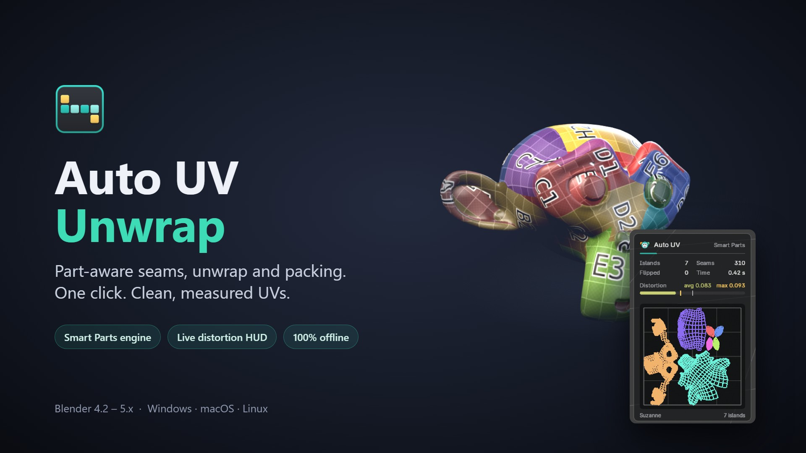

# Auto UV Unwrap – product page

Product page, images and GIFs for the **Auto UV Unwrap** Blender add-on on Superhive.

- Live page: `index.html` (served with GitHub Pages)
- Gallery images: `images/` (1920×1080 JPG, plus a 1080×1080 thumbnail)
- Animated demos: `media/*.gif` and `media/teaser.mp4`
- Superhive description (Markdown, copy-paste ready): `superhive_description.md`
- Documentation page: `docs.html`
- Superhive cover and 5 product images: `superhive/`

